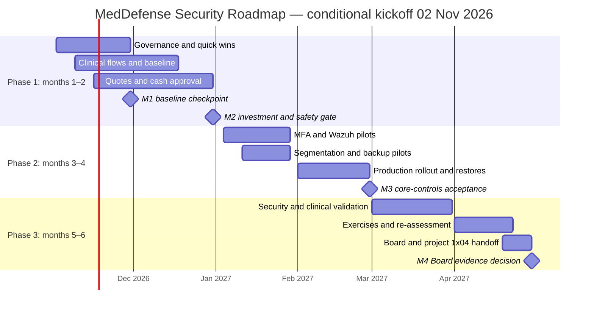
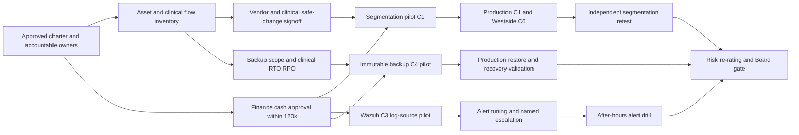

# MedDefense Health Systems — Six-Month Security Roadmap

**Project:** 1x03 — Defense Blueprint | **Task 18 — The Roadmap**  
**Audience:** Sarah Park (IT Director), James Chen (Deputy CISO), Robert Kim (CFO), Board, Clinical and Biomedical Leadership  
**Status:** **PROPOSED — NOT AUTHORIZED, FUNDED, DEPLOYED OR VERIFIED**  
**Baseline:** 29 October 2026 assessments; [Task 17 strategy](17-security_strategy.md)  
**Illustrative schedule:** **2 November 2026–30 April 2027**, assuming formal kickoff on 2 November 2026. **No approval or start has been evidenced.** If authorization occurs later, move all dates and reapprove the four milestone dates; Day 1 means the actual approved start date.

## 1. Operating Rules, Scope and Weekly Control

**Mission:** Reduce reachable identity and network attack paths, preserve clinical safety and restore capability, make detections actionable, and document remaining risks without claiming a paper plan equals operational security. Adopt NIST CSF 2.0 as the outcome framework, CIS Controls v8 as the safeguard checklist, and ISO/IEC 27001-aligned decision and evidence records. Six calendar months follow an approved kickoff; the example month labels below are **conditional**, not proof of past completion.

**Financial guardrail:** [Task 8](8-budget_allocation.md) selected **C2 MFA ($11,000), C1 segmentation ($30,000), C3 Wazuh ($22,000), C4 immutable offsite backup ($21,000), C6 Westside firewall ($13,000)**: **$97,000 annualized**. Upfront C1/C6 hardware treatment produces **$115,000 illustrative first-year cash** (`$97,000 - $9,000 annualized depreciation + $27,000 purchase cash`), only **$5,000** below the **$120,000 entire six-month program cash ceiling before unpriced obligations**. Annualized spending is not six-month cash flow. **Robert Kim must approve a complete dated six-month cash ledger, including staff, licensing, DPO/privacy, vendor, clinical, recovery and governance costs, before binding purchase orders.** No extra budget is assumed and no clinical minimum safeguard may be silently deferred for ROI reasons.

**Governance:** CEO/Board approve strategy, expenditure and exceptional risk decisions; James owns security oversight, risk register and incident command; **Sarah owns operational IT delivery**; Security Analyst checks evidence independently; Robert Kim owns cash challenge; DPO/EHR owner approve patient-data processing; Chief Pharmacist, Radiology and Biomedical/vendor teams authorize patient-impacting changes. The proposed RACI still requires formal adoption ([Task 4](4-governance_architecture.md)).

**Weekly wall-board fields:** Action ID | accountable owner | planned/actual start and end | dependency ID | state (`Not started / Blocked / In progress / Validation / Done`) | evidence link | open patient-safety/privacy issue | cash committed/forecast | next decision. Sarah chairs the weekly delivery review; James chairs risk escalation; Finance signs purchase gates. Only independent acceptance evidence moves an item to `Done`.

### Visual implementation timeline (illustrative dates)

**Reading the chart:** Dates are **targets**, not earned status. The arrows and hard start conditions below override any apparent overlap in the Gantt. Activities may be piloted in parallel, but dependent **production** changes cannot start merely because the calendar reaches January or February.

## 2. Month-by-Month Execution Plan

### Month 1 — November 2026 | Establish authority, perform safe quick wins

| ID | Specific action | Accountable owner / executors | Must be completed before starting | Evidence-based completion criterion |
|---|---|---|---|---|
| M1-A | Approve interim RACI, risk appetite escalation, named risk/control owners, clinical change veto and DPO contact. | **CEO**; James drafts, Sarah/Clinical/DPO review | Approved kickoff and leadership availability | Signed charter, decisions/minutes, 10 Risk Register owners and escalation contacts; unapproved items shown `Blocked`, not accepted. |
| M1-B | Disable **confirmed** stale VPN, vendor and privileged accounts (**T13 quick win 1; Day 3**). | **Sarah**; identity team, HR/vendor owners | Access inventory and owner validation; emergency accounts identified | **100% of confirmed stale accounts** disabled; failed stale-login test and successful approved emergency/vendor login; exceptions documented. |
| M1-C | Restore or individually exception **15 non-reporting Sophos agents** (**T13 quick win 2; Day 8**). | **Sarah**; endpoint team, departments | List of original 15, licenses and supported OS verified | **15/15 accounted for** as healthy or named, dated exceptions; benign alert/health check; no uncertified device agent. |
| M1-D | Pilot removable-media GPO on **10 noncritical administrative/billing hosts** (**T13 quick win 3; Day 10**). | **Sarah**; DPO, Clinical consulted | DPO/clinical media exceptions; pilot rollback documented | Unauthorized storage denied on every approved test host; necessary peripherals and authorized processes still work; GPO proof saved. |
| M1-E | Implement independent **pharmacist approval of dose-table changes** (**T13 quick win 4; Day 5**). | **Chief Pharmacist**; pharmacy application/IT teams | Named independent reviewer, current approved dose reference and staging procedure | Test-only incorrect change rejected; two different approvers and safe three-site release/rollback recorded. |
| M1-F | Start daily review of available EHR export logs (**T13 quick win 5; Day 7**). | **EHR Clinical Data Owner**; DPO reviewer, IT reports | Minimum-necessary audit access and approved export-role list | **Five consecutive dated reviews**, backup reviewer and simulated escalation ticket; ~48-hour audit delivery delay remains **open KRI**, not falsely marked fixed. |
| M1-G | Reconcile critical asset owners and baseline open findings: 031/003/004/010/001/008/002, PACS restore gap and RISK-007. | **James**; Security Analyst, Sarah, Biomedical | Access to 1x00 inventory, 1x02 triage and Task 10 register | Ticket for each immediate finding with owner, clinical constraints, due date, safe validation; false-positive/CVE disputes separately checked. |

**Month 1 acceptance:** The **five** quick wins each have a state and evidence/exception, urgent patient-safety actions have accountable owners, and governance changes are either signed or escalated. A quick-win pilot is not proof of enterprise coverage. [Task 13](13-quick_wins.md) originally proposed **30 October–12 November 2026**; those are historical proposal dates, **not evidence that execution began**. Rebase Day 1–14 at actual approval.

### Month 2 — December 2026 | Define flows, recovery, procurement and go/no-go

| ID | Specific action | Accountable owner / executors | Must be completed before starting | Evidence-based completion criterion |
|---|---|---|---|---|
| M2-A | Map actual permitted flows, dependencies and proposed T14 security zones: **Z-ID, Z-DATA, Z-SRV, Z-CLIN, Z-MED, Z-IMG, Z-MGMT, Z-GUEST, Z-DMZ, Z-BACKUP**, VPN and Westside. | **Sarah**; network/EHR/AD/clinical owners | M1-G inventory, site owners and baseline paths | Signed source–destination–port–purpose matrix; legacy DNS/AD RPC/DICOM/HL7, maintenance and same-VLAN isolation tested in design; proposed 10.20.x.x ranges conflict-checked. |
| M2-B | Sign clinical-safe change/test plans for MRI, PACS, Alaris, Philips, pharmacy and Westside intersite services. | **Radiology/Biomedical/Chief Pharmacist** for their clinical domain; vendors, Sarah | M2-A preliminary flows and current vendor service requirements | Approved test windows, **positive clinical** and **negative security** cases, stop conditions, downtime communications and rollback approvals. |
| M2-C | Set scope and **clinical RTO/RPO**, backup/retention inventories and independent PACS image **plus metadata** restore design. | **Sarah**; Radiology/PACS/EHR/AD/billing owners, DPO | M1-G inventory; affected clinical owner appointment | Signed protection and restore matrix; immutability/credential separation and retrieval times evaluated; PACS gap is explicitly open until restoration. |
| M2-D | Check existing MFA entitlement/urgent break-glass, Wazuh storage and staffed escalation, Westside hardware requirements and supplier security terms. | **Sarah**; James, Procurement, DPO | M1-A approval paths, M2-A system scope | Pilot specification, staff/on-call coverage plan and exact vendor quotes; no assumption of 24/7 SOC or existing licensing. |
| M2-E | Approve and baseline **complete six-month cash flow ≤$120,000**, staged releases for C1/C2/C3/C4/C6; approve AUP and interim incident/legacy exception procedures. | **CEO** (spend/policy); **Robert Kim** (finance); James/Legal/DPO | M2-B/C/D quotations, cash timing, signed owner responsibilities | Signed budget by payment date incl. unpriced obligations; purchase orders permitted only for affordable, safe scope; signed AUP or tracked blocker; explicit go/no-go. |

**Month 2 acceptance:** No clinical-zone cutover, new license purchase or production MFA lockout before **M2-E** financial authorization and clinical approvals. An annualized $97,000 list alone **does not** meet this gate.

### Month 3 — January 2027 | Build and validate non-disruptive pilots

| ID | Specific action | Accountable owner / executors | Must be completed before starting | Evidence-based completion criterion |
|---|---|---|---|---|
| M3-A | Pilot **C2** named VPN/admin MFA, vendor expiry and emergency access; validate AD-dependent workflows. | **Sarah**; identity administrators, Clinical | M2-D entitlement and break-glass design; M2-E procurement | Scoped users denied password-only remote entry; valid sign-in works; emergency access drill documented; pilot exceptions ticketed. |
| M3-B | Pilot **C1** deny-by-default rules for guest/VPN/admin/database/AD paths using T14 rule intent, not a blind ten-rule copy. | **Sarah**; network team, Security Analyst | **M2-A** signed flow matrix, **M2-B** safety/rollback, **M2-E** authorization | Test source denied inappropriate DB/AD/AJP/SMB reachability; approved EHR, AD, DICOM and device test flows still work; firewall logs and rollback saved. |
| M3-C | Configure **C3 Wazuh** and ingest representative VPN, firewall, AD, EHR/PACS logs where supported. | **Sarah** platform; **James** alert ownership; analyst | M2-D compute, log-access/privacy policy and assigned human responders; M2-E | Timestamped event from each pilot source appears, named triage owner acknowledges a synthetic alert; EHR export lag reported, not concealed. |
| M3-D | Pilot **C4** independent immutable backup and one isolated non-production/approved test restoration. | **Sarah**; recovery/Clinical/Radiology | **M2-C** RTO/RPO and restore scope; M2-E quote/purchase approval | Object lock and separation of deletion authority demonstrated; restore is usable with images + metadata where in pilot scope; timed output documented. |
| M3-E | Prepare **C6** Westside firewall staging and controlled intersite failover plan. | **Sarah**; site manager, network vendor | **M2-A/B** Westside flows and test window; M2-E procurement | Hardware licensed/ready; policy and rollback exported; representative approved clinic connection tests passed before cutover. |

**Month 3 acceptance:** All five selected controls have at least a permitted **test/pilot plan and measurable pilot evidence**, or documented procurement/clinical blockers. This is **not** production deployment acceptance.

### Month 4 — February 2027 | Stage and accept core production controls

| ID | Specific action | Accountable owner / executors | Must be completed before starting | Evidence-based completion criterion |
|---|---|---|---|---|
| M4-A | Roll **C2** MFA to all in-scope privileged human/VPN accounts in approved waves. | **Sarah**; identity admins, HR, clinical owner | **M3-A** pilot passes, approved emergency access | **100% in-scope** protected or individually approved time-limited exception; denial of password-only login and break-glass drill proven. |
| M4-B | Roll out **C1** restricted zones, explicitly validate EHR app→DB TCP 5432 and MRI→PACS DICOM; keep clinical/vendor maintenance safe. | **Sarah**; network team, EHR owner, Biomedical/Radiology | **M3-B** passed, **M2-B** active vendor/clinical clearance; route cutover window | All approved allow/deny tests pass; **zero unexplained forbidden tested paths**; PACS images, pump telemetry, AD and EHR functionality preserved; reversal tested. |
| M4-C | Replace Westside perimeter with **C6** managed firewall and remove unapproved broad intersite trust. | **Sarah**; Westside manager and vendor | **M3-E** staging, M4-B relevant routes and safe rollback approval | No unintended intersite clinic outage; prescribed denied test routes blocked and alerts forwarded; hardware/rule exports archived. |
| M4-D | Complete **C4** protected critical copies and **full representative application restore** for PACS/EHR/AD/billing. | **Sarah**; Radiology, EHR/AD/billing and DPO | **M3-D** pilot, approved RTO/RPO and required storage tier | Every in-scope backup set independently restorable; images and metadata validated where applicable; restoration times recorded and agreed objectives met **or formally escalated**. |
| M4-E | Promote **C3** prioritized Wazuh sources to operational alerting with on-call handoff. | **James** detection accountability; Sarah platform, analyst triage | **M3-C** source pilots and privacy approval; named after-hours contact | **100% priority feeds active or excepted**; tested critical alert reaches a human within signed SLA; no implied staffed 24/7 SOC. |
| M4-F | Validate urgent vulnerability closures and minimum medically safe Alaris/MRI/pharmacy protections. | **Sarah** for IT; **Biomedical/Chief Pharmacist/Radiology** for safety; analyst verifies | M2-B clinical approvals, M4-B allowed paths, original T23 validation plan | Finding-specific verified change + safe negative and positive tests, signed clinical acceptance; unsupported XP remains **compensated**, not patched; unresolved CVE associations labeled uncertain. |

**Month 4 acceptance:** Each C1/C2/C3/C4/C6 has production evidence or an explicit `Blocked / not deployed` label, a responsible owner, rollback and bounded exceptions. **No risk is automatically re-rated when a tool is installed.**

### Month 5 — March 2027 | Independent testing and risk-calibrated adjustments

| ID | Specific action | Accountable owner / executors | Must be completed before starting | Evidence-based completion criterion |
|---|---|---|---|---|
| M5-A | Execute least-privilege **positive/negative** access tests, safe vulnerability rescans and T14 policy drift checks. | **Security Analyst** verifies; Sarah fixes; Clinical/Biomedical authorize device tests | M4-A/B/C change evidence; vendor-approved method and windows | Unauthorized VPN→AD, guest→clinical, unrelated host→DB/medical management denied; required clinical workflows succeed; open defects ticketed. |
| M5-B | Perform timed restore drills for PACS images/metadata, EHR, AD and billing; verify backup immutability and key custody. | **Sarah**; Radiology/EHR/IT recovery owners | M4-D backups complete and RTO/RPO agreed | Clinical users confirm usable restored data and time objectives; **no failed test is closed by exception alone**; corrective retest date recorded. |
| M5-C | Exercise Wazuh alert-to-human escalation (daytime and after-hours) and EHR export/USB/pharmacy exception paths. | **James** incident lead; DPO, Chief Pharmacist, analyst | M4-E operational alerts, M1-C/D/E/F pilots, approved privacy retention | Synthetic indicators create owned incident tickets; elapsed acknowledgment measured against signed SLA; no unowned high-priority alert or unsafe clinical dose change. |
| M5-D | Update each **RISK-001–010** record and KRI status using test outcomes, not theoretical T8 risk reduction. | **James**; risk owners, Security Analyst | M5-A/B/C measured outcomes | Dated residual assessment for all 10, tested or open status, owner and next review; high/critical exceptions remain unsigned unless CEO formally approves. |

**Month 5 acceptance:** A failed patient-safety or recovery test blocks the affected expansion/closure, triggers an approved rollback/containment path and goes to James plus the accountable clinical leader.

### Month 6 — April 2027 | Reassess maturity, close evidence gaps and request next decisions

| ID | Specific action | Accountable owner / executors | Must be completed before starting | Evidence-based completion criterion |
|---|---|---|---|---|
| M6-A | Complete multidisciplinary KC1/KC3 ransomware/PACS and KC2 pharmacy integrity tabletop; repeat critical failed tests. | **James**; Sarah, Clinical/Radiology, DPO, Pharmacy | M5-B/C results, incident contacts, recovery paths | At least **one documented multidisciplinary exercise** and corrective retests; decision and escalation logs; approved clinical fallback and RTO/RPO results. |
| M6-B | Re-score NIST CSF six functions and CIS 18 Controls; review AUP, exceptions and outstanding RISK-007 privacy exposure. | **James**; analyst, Sarah, DPO, Clinical | M5-D register, control and policy evidence | Six evidence-backed CSF profiles, 18 whole-Control ratings, **10/10 risks reviewed**, explicit residual Critical if not treated; no invented certification. |
| M6-C | Reconcile actual vs authorized cash and propose Year 2 EDR/clinical-device/privacy coverage options. | **Robert Kim** financial; James/Sarah requirements, Biomedical/DPO | M2-E approved cash ledger and M6-B evidence | **Total committed/paid six-month program cash ≤$120,000** or overrun escalated before payment; revised quoted backlog and decisions, no extrapolated guaranteed ALE saving. |
| M6-D | Transfer certificate/DICOM TLS, LDAP/Kerberos, secure vendor/backup key and crypto-trust gaps to **Project 1x04**. | **James** sponsor; Sarah technical, DPO/Clinical/vendor input | M5 validation, M6-B control gaps and signed compatibility inventory | Risk-ranked crypto backlog, owning teams, clinical tests, certificate/key inventory, separate cost/approval requirements; no unapproved protocol cutover. |
| M6-E | Board-close the six-month cycle with evidence package and next-cycle authorizations. | **CEO/Board**; James presents, Sarah/R. Kim attest | M6-A/B/C/D completed or blockers explicitly listed | Signed Board minutes, delivered artifacts, stated residual risks, budget variance, corrective owners and next review/approval dates. |

**Month 6 acceptance:** A traceable evidence pack exists. `Partial` is an acceptable honest maturity result when proof is insufficient. A Critical residual exposure (especially **RISK-007**) cannot be declared solved by C1–C6 alone.

## 3. Explicit Dependency Chain — Hard Gates

**The six non-negotiable sequencing rules:**

1. **Asset/flow inventory → clinical/vendor approval → C1 segmentation pilot → production C1/C6 cutover.** Do not mistake VLAN creation for protection, or assume medical-device VLAN restrictions are safe before verified allowed paths; same-VLAN traffic needs its own enforcement.
2. **C3 Wazuh log-source ingest → detection rules/triage ownership → alert-to-human drill.** A central log server cannot be credited with threat detection until an actionable alert and a person receiving it are demonstrated.
3. **Critical-service scope + Radiology RTO/RPO → C4 immutable copies → application-consistent full restore.** Object Lock without usable PACS images and metadata is not a recovery milestone.
4. **MFA entitlement + documented break-glass → C2 pilot → enterprise expansion.** No production identity lockout without an approved emergency-care path.
5. **Written cash and purchasing approvals → equipment/license orders → production deployment.** The $97k annualized estimate does not release cash under the actual $120k six-month ceiling.
6. **Successful allowed/denied tests + clinical sign-off + dated operational evidence → residual risk reassessment/closure.** An implementation ticket, passing scanner banner or T15 hypothetical red-team assumption does not prove treatment.

## 4. Four Formal Milestones (Conditional Dates)

| Milestone / scheduled date | Accomplished only when | Measurable success indicator | Decision gate and owner |
|---|---|---|---|
| **M1 — 30 Nov 2026: Authority + rapid baseline** | Governance authority assigned, 5 T13 quick wins attempted safely, immediate risk and safety work ticketed. | **5/5 wins recorded** `Done/Partial/Blocked` with evidence; 15 Sophos entries accounted for; 10/10 risks have named role owners; **0 unresolved confirmed stale identities without containment/escalation**. | **James** verifies; **CEO** signs authority. A blocked win is **not** counted as complete. |
| **M2 — 31 Dec 2026: Design and investment go/no-go** | Approved flows, clinical/vendor rollback, restoration needs and realistic procurement options prepared. | Signed in-scope flow matrix, **100% critical assets assigned owner**, PACS/EHR/AD/billing RTO/RPO defined, full dated **six-month cash plan ≤$120k** or explicit **NO-GO** with recovery plan. | **Robert Kim/CEO** spending gate; **Sarah + Clinical/Biomedical** change gate. |
| **M3 — 28 Feb 2027: Core controls accepted** | Authorized C1/C2/C3/C4/C6 pilot and production deployment passed required tests. | **100% in-scope privileged/VPN MFA or signed exceptions**; **0 unexplained forbidden test paths**, clinical positive tests pass; critical backup sets restored or documented failures; priority alert sources active/excepted and human drill passes. | **Sarah** delivery; **James** independent security sign-off; Clinical approves safety. Blocked subcontrols remain open. |
| **M4 — 30 Apr 2027: Verified six-month program** | Independent checks, recovery and incident exercises, risk and framework reassessments, financial reconciliation and 1x04 handoff delivered. | **10/10 risks reviewed**; **6/6 NIST functions and 18/18 CIS Controls re-scored** with evidence; at least **1 multidisciplinary tabletop**; spend within signed $120k or breach escalated; **0 unapproved high/critical acceptances**. | **CEO/Board** approval or corrective-action direction; **James/Sarah/Robert** provide evidence. |

**Milestone convention:** These dates are planning anchors based on a **hypothetical** 2 November start; all four remain **Not started / subject to authorization** until actual evidence is attached. Missed checkpoints require a new dated, approved baseline and must never be silently backdated.

## 5. The Two Most Likely Schedule Slippages and Contingencies

| Risk to timeline | Early warning and impact | Concrete contingency and accountability |
|---|---|---|
| **S1 — Budget, vendor-quote and procurement mismatch.** The $115k *first-year* illustrative cash leaves only $5k vs the $120k *six-month total* cap before DPO, licensing, staffing/vCISO, clinical vendors and procurement. | **By mid-December:** supplier proposals incomplete, MFA entitlement uncovered, storage retrieval too expensive, or cash ledger >$120k; Month 3 purchase and Months 3–4 deployments slip. | **Robert Kim + CEO/James:** hold new purchase orders, get fixed-scope quotes, distinguish immediate clinically mandatory measures from optional scope, rephase/resize noncritical C3 additions or nonurgent hardware while preserving identity, essential medical containment and **proven PACS recovery**. Task 8's cheaper $76k allocation that defers C4 is **not** automatically safe without independently verified alternative backup. Record a new signed milestone baseline and unmitigated risks; never spend over cap silently. |
| **S2 — Clinical/vendor compatibility and incomplete network dependencies.** XP MRI, Alaris, Philips, PACS DICOM/HL7 and AD dynamic dependencies may fail naive ACL cutovers; vendor availability and patient-safety windows can delay C1/C6/C4 acceptance. | **By early December:** unknown ports or missing biomedical sign-off; **by January pilot:** a permitted PACS, pump, AD or pharmacy test fails; production cutover would be unsafe. | **Sarah + Radiology/Biomedical/vendors:** preserve the last safe configuration, stop/roll back the affected change, use passive controls and source-based isolation at approved network boundaries, split rollout by site/zone, book vendor-supervised maintenance and retest both clinical allow and unauthorized deny. Escalate urgent exposure to James/CEO; keep finding `Open`/`Compensated` and reschedule dependent tasks. **Never run intrusive scans or unsupported agents on active medical devices.** |

Both contingencies require a **weekly forecast update**, owners, new dates and explicit patient-care/KRI escalation. A delay is not a risk-acceptance decision; high/critical exceptions require the proposed CEO/Board authorization procedure in [Task 16](16-risk_appetite.md).

## 6. Weekly Delivery Scoreboard and End-State Proof

| Weekly reported metric | Baseline (1x00–1x03) | Target / exception rule |
|---|---|---|
| Confirmed stale VPN/admin identities | Count requires M1 inventory | **0** confirmed stale active, with dated named exceptions where investigation is incomplete. |
| Sophos silent devices | **15** (Finding 027) | **15/15 resolved or individually owned exceptions**; none ignored. |
| MFA for in-scope VPN/privileged identities | Organization-wide coverage unproven | **100%** deployed or signed time-limited exception; successful break-glass test. |
| Forbidden interzone paths / required care flows | Flat, broad VPN/server trust; T14 design only | **0 unexplained allowed unauthorized tested routes**, **100% required approved clinical workflow tests pass**. |
| Critical protected recovery | PACS independent restoration not evidenced | Signed scope + recoverable data, PACS images/metadata, measured RTO/RPO and failure tickets. |
| Alert-to-human monitoring | No evidenced staffed SIEM | **All defined priority feeds active or excepted**, alert delivery and human acknowledgment measured vs signed SLA; no fictional 24/7 SOC. |
| Pharmacy independent dose release | Historic unsafe update, control not proven | **100% sampled changes** have two different approvals and approved dose references; 0 unexplained exceptions. |
| EHR bulk-export audit lag | Approximately **48 hours** | Target **≤24 hours**, otherwise signed compensating control and open risk; daily retrospective review alone does not meet latency target. |
| Risk and expense governance | Ten risk records marked **Mitigate**, funding unapproved | 10/10 reviewed, 0 unsigned high/critical acceptances; spend forecast and commitments **within approved full-program ceiling**. |

**Finish-line definition:** The roadmap is complete **only after documented changes, successful negative and positive security/clinical tests, recoverable backups, observable human incident response, updated Risk Register, signed financial decisions and a credible 1x04 cryptography backlog**. Because Task 15 still models **Critical** overall residual risk due to RISK-007, completion of a six-month *schedule* never implies the hospital is low risk.

## 7. Links to Source Deliverables and Next Project

- [Task 4 — Governance Architecture](4-governance_architecture.md): decision authority and RACI.
- [Task 8 — Budget Allocation](8-budget_allocation.md): $97k annualized conditional selection, cash discrepancy and alternatives.
- [Task 10 — Risk Register](10-risk_register.md): RISK-001–010, owners, open state, residual conditions and KRIs.
- [Task 11 — Control Selection](11-control_selection.md): risk-to-CIS/NIST implementation decisions.
- [Task 12 — Acceptable Use Policy](12-acceptable_use_policy.md): proposed patient-data, USB and access policy.
- [Task 13 — Quick Wins](13-quick_wins.md): five Day 1–14 safe actions and specific acceptance evidence.
- [Task 14 — Segmentation Architecture](14-segmentation_architecture.md): proposed zones, network rule intent and clinical validation matrix.
- [Task 15 — Red Team Blueprint](15-red_team_blueprint.md): conditional PACS/KC3 residual risk and detection constraints.
- [Task 16 — Risk Appetite](16-risk_appetite.md): clinical risk limits, time-bounded exceptions and CEO/Board sign-off.
- [Task 17 — Security Strategy](17-security_strategy.md): endorsed direction sought, not currently demonstrated.
- [Project 1x02 — Vulnerability Validation](../1x02_the_weak_links/23-validation_plan.md): safe rechecks and medical-device constraints.
- **Project 1x04 — Cryptographic Foundation handoff:** inventory DICOM TLS, LDAP signing/Kerberos configuration, VPN/SSH/TLS and certificate trust, encrypted backups and key custody with clinical/vendor support and a separately approved budget.

**Prepared for decision; not proof of MedDefense deployment.**
